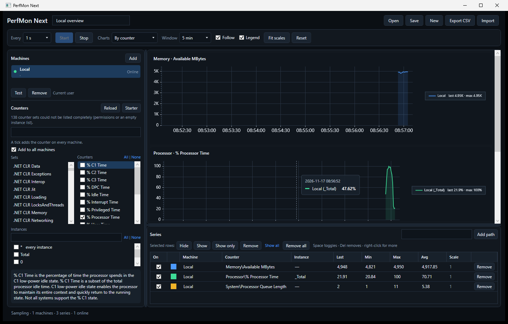

<p align="center">
  
</p>

# PerfMon Next

PerfMon Next is an open-source Windows desktop app for watching performance counters on one computer or across several machines at once — for example the nodes of a Windows Server or Azure Local cluster. It is a modern replacement for Performance Monitor (perfmon), with a dark workspace, a searchable counter picker, live charts, and a table of last / min / max / average values.



## Features

- Live charts grouped by counter, by machine, or combined, plus a series table (last, min, max, average, scale)
- **Table only** mode that turns the charts off and keeps the series report updating, handy with many series
- Grafana-style charts: a crosshair with a hover card showing the time and every series' real value (K/M/G with units), a Y axis that starts at 0, compact K/M/G ticks, and a legend with last and max
- Compact chart legend (up to 6 entries plus "+N more") that you can switch off, a readable time axis, and **Reset** to put every chart back to the default view
- Hover anywhere on a chart for the exact values; the card hides when you point at a gap with no samples
- Make any chart taller or shorter by dragging its bottom edge (double-click the edge to reset); heights are saved with the workspace
- Bulk work in the series table: multi-select rows, then **Hide**, **Show**, **Show only**, or **Remove** them (also on the right-click menu; **Space** toggles, **Delete** removes), or **Remove all** to start over with the same machines
- Bulk selection in the picker: **All** / **None**, Shift-click ranges, **Ctrl+A**, and an instance filter
- Type a **cluster name** in Add machine and every node of that failover cluster is added automatically
- Searchable counter picker with explain text, a built-in starter catalog, and **Add path** for pasted PerfMon-style paths
- Several machines in one workspace, optional alternate credentials (passwords stay on this PC, never in the workspace file)
- Workspace files you can save and reopen, CSV export/import, and import of Performance Monitor `.blg` logs
- A self-contained 64-bit Windows build: unzip and run, no .NET install required

## Download

Get the latest signed build from **[Releases](https://github.com/EquiByteCZ/perfmon-next/releases)**.

1. Download `PerfMonNext-win-x64.zip`.
2. Unzip it to a folder of your choice.
3. Run `PerfMonNext.exe`.

### winget

```powershell
winget install EquiByte.PerfMonNext
```

This works once the package is accepted into the [winget community repository](https://github.com/microsoft/winget-pkgs) (submission pending review). winget installs it as a portable app and adds a `perfmon-next` command.

### Signing and SmartScreen

`PerfMonNext.exe` is signed by **EquiByte s.r.o.** with Azure Artifact Signing (public trust). Windows SmartScreen may still warn on the first run until the publisher builds reputation. If you see that dialog, open the publisher details and confirm the signer is EquiByte s.r.o. before you continue.

## Requirements

- 64-bit Windows 10, Windows 11, or Windows Server (the app is a WPF desktop program)
- To read **local** counters, your account needs to be able to use Performance Monitor as usual (Administrators or **Performance Monitor Users**)
- To read **remote** counters, see [Adding remote machines](#adding-remote-machines) below

The released ZIP is self-contained. You do not need to install the .NET 8 desktop runtime to run it.

## Quick start

1. Download and unzip the release, then start `PerfMonNext.exe`.
2. A default **Local overview** workspace is already set up with this computer (`.`) and three counters: `Processor\% Processor Time` (`_Total`), `Memory\Available MBytes`, and `System\Processor Queue Length`.
3. Press **Start** (or **F5**). The first sample of a rate counter is discarded, so values typically appear on the second interval (about one more second at the default 1 s interval).
4. Point at a chart to see the time and the value of every series under the crosshair. Use **Follow** to keep the time axis on the latest samples; turn it off to pan (drag) and zoom (mouse wheel). **Reset** returns every chart to the default view. **Fit scales** helps when one chart mixes big and small series (see the [user guide](docs/user-guide.md#fit-scales-and-reset)). CSV export always stores raw values.
5. Add more counters from the picker on the left, or paste a path such as `\Processor(_Total)\% Processor Time` and click **Add path**.
6. **Ctrl+S** saves the workspace, **Ctrl+O** opens one.

See the [user guide](docs/user-guide.md) for a walkthrough with screenshots.


See the [user guide](docs/user-guide.md) for a walkthrough with screenshots.

## Adding remote machines

Use **Add** in the Machines list. Host can be a computer name or IP address. `.` means this computer. If the name is a Windows failover cluster (for example an Azure Local or Hyper-V cluster name), PerfMon Next reads the cluster's node list and adds every node instead of the cluster name; a node name or an ordinary server is added as typed. The node list is read over WMI (`root\MSCluster`) with the same credentials. If it cannot be read, the typed host is added on its own and the status bar says why. **Test** reads `Memory\Available MBytes` and shows online, access denied, or offline on that row.

The app reads as the signed-in user unless you tick **Different credentials**. The password is kept in memory for the session. **Remember on this PC** stores it with DPAPI under `%AppData%\PerfMonNext\credentials.json`. Workspace JSON never contains a password; if one is present it is ignored.

If Windows already has a session to that host as someone else, the connect fails with a message that includes `net use \\host /delete`.

On **each target machine**:

1. Start the Remote Registry service and set it to automatic:

   ```powershell
   Set-Service RemoteRegistry -StartupType Automatic
   Start-Service RemoteRegistry
   ```

2. Allow the firewall groups Performance Logs and Alerts, File and Printer Sharing, and Remote Service Management:

   ```powershell
   Enable-NetFirewallRule -DisplayGroup "Performance Logs and Alerts"
   Enable-NetFirewallRule -DisplayGroup "File and Printer Sharing"
   Enable-NetFirewallRule -DisplayGroup "Remote Service Management"
   ```

   That covers RPC (TCP 135 plus dynamic ports) and SMB (TCP 445), which remote performance data (PDH) needs.

3. Put the account in **Performance Monitor Users** (read counters) or Administrators. **Performance Log Users** is the group used by Data Collector Sets (`logman`), not by a live read.

4. The account also needs "Access this computer from the network". A few counters still fail unless the account can read `HKLM\SOFTWARE\Microsoft\Windows NT\CurrentVersion\Perflib`.

## Hyper-V counters

Hyper-V (and Cluster CSV) counters exist only when those roles are installed on the target. A missing counter is reported on that machine and the others continue.

When you select a remote multi-instance set such as **Hyper-V Hypervisor Logical Processor**, PerfMon Next enumerates instances with several methods: a fresh category sample (`ReadCategory`), PDH `PdhEnumObjectItems` after a refresh, and `GetInstanceNames`. A bulk catalog query often returns empty instance lists for those sets.

If a multi-instance set still has no instances after that, the app shows an error and a **Retry** button instead of treating the set as single-instance. When `_Total` is available, that instance is selected by default. If a sample cannot be read, the series row shows the error instead of a silent "—".

## Export and import

| File | Contents |
| --- | --- |
| Workspace JSON | Machines, counter selections, interval, history length, chart grouping, colors, scales, visibility. No passwords. |
| CSV export | `timestamp,machine,category,counter,instance,value`. Gaps are empty cells. |
| PDH-CSV | The header `relog -f CSV` writes. Import detects it. |
| `.blg` | On Windows, PerfMon Next runs `relog.exe file.blg -f CSV -o file.csv -y` and imports that CSV. |

Use **Export CSV**, **Import**, and **Open** / **Save** in the toolbar, or **Ctrl+O** / **Ctrl+S** for workspaces.

`samples/azure-local-cluster.workspace.json` is a three-node example workspace (CPU, memory, queue, Hyper-V logical processor, CSV read latency). Change the host names before you start it.

## Build from source

You need the [.NET 8 SDK](https://dotnet.microsoft.com/download/dotnet/8.0). The UI is WPF, so it runs only on Windows; the solution also compiles and tests on Linux and macOS (`EnableWindowsTargeting`).

```powershell
git clone https://github.com/EquiByteCZ/perfmon-next.git
cd perfmon-next
.\build.ps1                                        # tests + framework-dependent publish to artifacts\win-x64
dotnet run --project src\PerfMonNext.App -c Release # run from source
```

On Linux or macOS, `./build.sh` runs the unit tests and cross-compiles the Windows projects.

A self-contained single-file build like the release:

```powershell
dotnet publish src\PerfMonNext.App\PerfMonNext.App.csproj -c Release -r win-x64 --self-contained true `
  -p:PublishSingleFile=true -p:IncludeNativeLibrariesForSelfExtract=true -p:EnableCompressionInSingleFile=true `
  -o artifacts\win-x64
```

### Project layout

| Path | What it is |
| --- | --- |
| `src/PerfMonNext.Core` | Workspace model, sampling, series store, chart math, import/export. Platform-neutral and unit-tested. |
| `src/PerfMonNext.Windows` | PDH / PerformanceCounter reading, catalogs, cluster node lookup (WMI). |
| `src/PerfMonNext.App` | WPF UI (.NET 8) with ScottPlot 5 charts. |
| `tests/` | xUnit tests for Core and the local Windows catalog. |
| `.github/workflows/build.yml` | Tests on Linux and Windows, self-contained publish, CI screenshots; on `v*` tags signs the EXE and publishes the release. |

### Releases and signing

Pushing a `v*` tag runs the `release` job: it signs `PerfMonNext.exe` with Azure Artifact Signing (OIDC, no stored keys), verifies the signature, and publishes the ZIP to this repository's Releases. The `release` environment only accepts `v*` tags, so pull requests and forks cannot sign.

## Contributing

Issues and pull requests are welcome.

- Open an issue first for larger changes, so we can agree on the approach.
- Keep pull requests focused; add or update tests in `tests/PerfMonNext.Core.Tests` when you change logic in Core.
- Run `dotnet test -c Release` before you push. CI must be green.
- UI text is English and the theme is dark; keep text readable on the dark background.
- By contributing you agree that your contribution is licensed under the MIT License.

## License

[MIT](LICENSE) © 2026 EquiByte s.r.o.

## Built by EquiByte


PerfMon Next is built by <a href="https://equibyte.cz/en/">EquiByte s.r.o.</a> — Azure Local and Hyper-V consulting and deployments.
Need help planning or running an Azure Local cluster? See <a href="https://equibyte.cz/en/azure-local/">equibyte.cz/en/azure-local</a> or write to <a href="mailto:Jaromir@equibyte.cz">Jaromir@equibyte.cz</a>.
